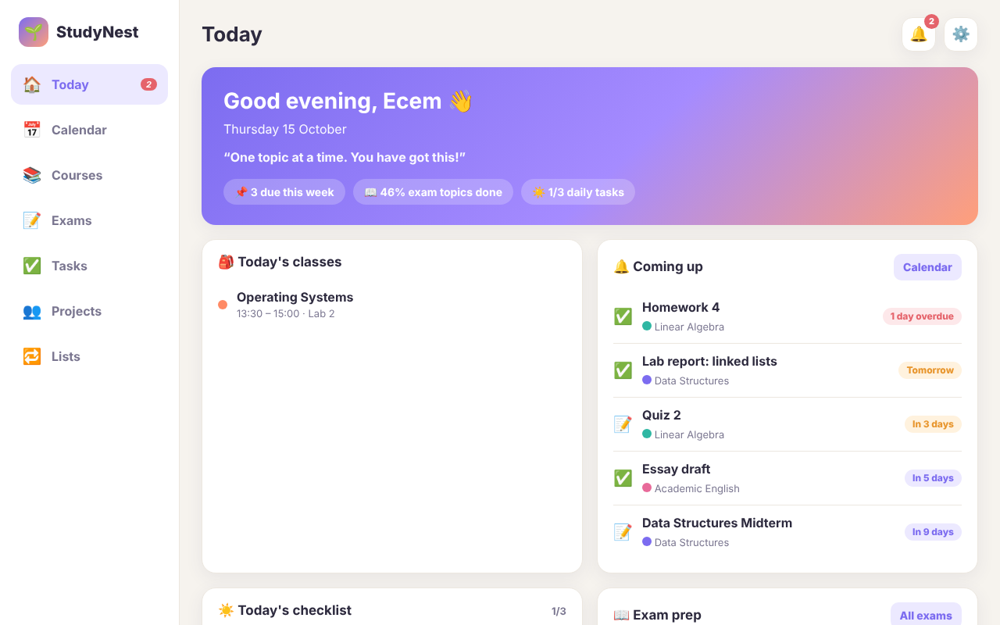
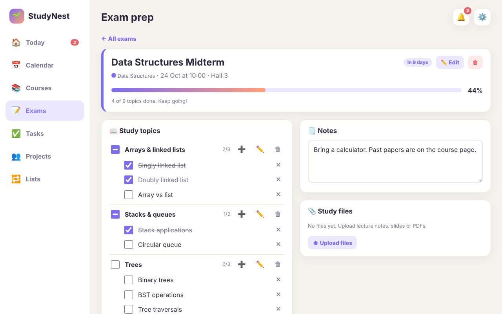
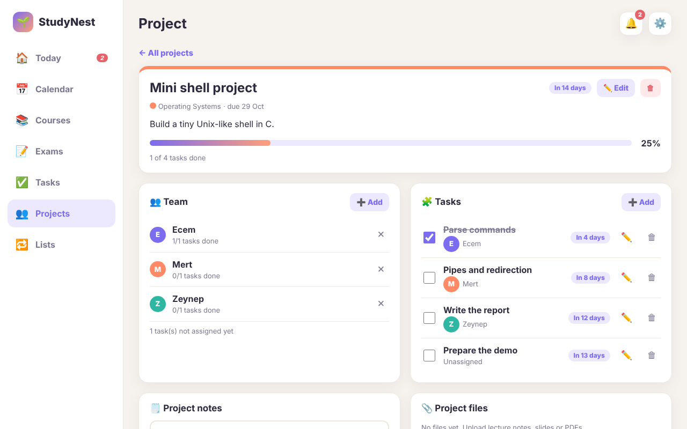
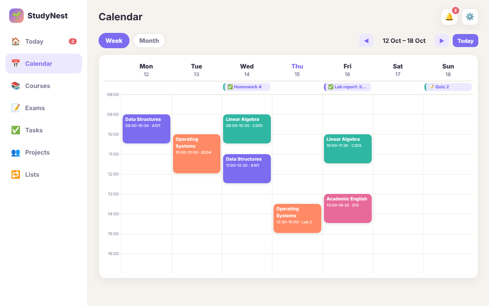
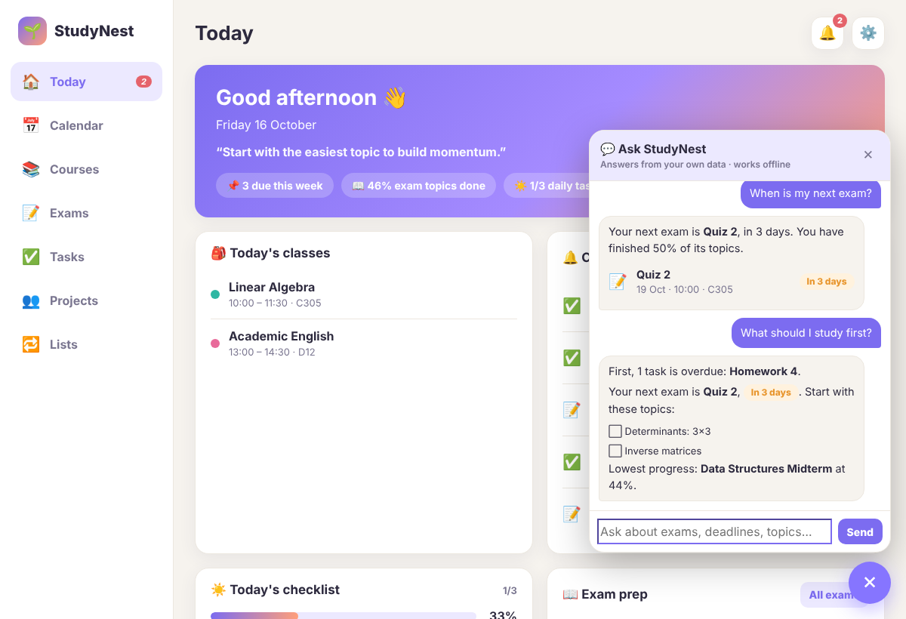
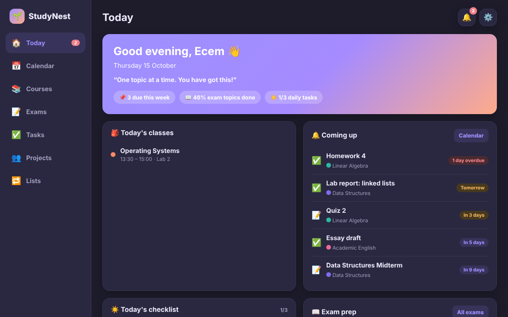
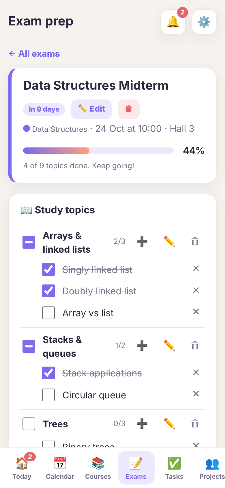

<div align="center">

# 🌱 StudyNest

**A calm, motivating study planner for university students.**
Timetable, exam prep with progress tracking, assignments, group projects and repeating to-do lists, all in one place.

[**▶ Live demo**](https://ecemkaradas.github.io/studynest/) &nbsp;·&nbsp; HTML · CSS · JavaScript · no dependencies · works on phone, tablet and desktop



</div>

## Why I built it

During the semester my classes, exam topics, homework deadlines and group-project tasks were spread across notes apps, chats and spreadsheets. I wanted one place where I can see what is due, what I still have to study for an exam and who is doing what in a group project, with an interface that is calm and motivating instead of stressful.

StudyNest is the result. I use it for my own university life.

## Features

| | |
| --- | --- |
| 📅 **Calendar** | Weekly timetable with class times and rooms, plus a month view with exams and deadlines. |
| 📝 **Exam prep** | Add midterms, finals and quizzes with the topics and subtopics that will be asked. Tick them off and watch the **progress bar and percentage** update. |
| ✅ **Assignments** | Tasks grouped into overdue, today, this week and later. |
| 👥 **Group projects** | Team members, tasks assigned to people, per-person progress, project notes and files. |
| 🔁 **Repeating lists** | Daily, weekly and monthly lists that reset on their own when the day, week or month changes. |
| 💬 **Ask StudyNest** | A built-in assistant that answers questions from your own data: *"What is due this week?"*, *"What topics are in the midterm?"*, *"What should I study first?"*. Works offline, no account, English and Turkish questions. |
| 🔔 **Reminders** | A notification box for deadlines and exams that are coming up. |
| 📎 **Notes and files** | Upload PDFs, slides and notes to courses, exams and projects. |
| 🎨 **Look and feel** | Soft colours, light and cosy dark theme, encouraging messages and small celebrations when you finish something. |
| 💾 **Backup** | Export and import all your data as a JSON file. |

<table>
<tr>
<td width="50%"><br><sub>Exam prep: topics, subtopics and progress</sub></td>
<td width="50%"><br><sub>Group project: team, assigned tasks, progress</sub></td>
</tr>
<tr>
<td><br><sub>Weekly timetable with deadlines</sub></td>
<td><br><sub>Ask StudyNest: questions answered from your own data</sub></td>
</tr>
<tr>
<td><br><sub>Cosy dark theme</sub></td>
<td></td>
</tr>
</table>

<p align="center"><br><sub>Responsive: bottom navigation on phones and tablets</sub></p>

## Engineering highlights

- **Zero dependencies, zero build step for users.** The whole app ships as a single `index.html` (plain HTML, CSS and JavaScript), so it can be hosted anywhere, for example GitHub Pages.
- **Single source of truth.** All data lives in one state object. Every change goes through one `commit()` that saves and re-renders, which keeps the UI always consistent with the data.
- **Derived progress.** Progress for exams and projects is calculated from the data instead of being stored. A topic with subtopics becomes "done" only when all its subtopics are, shows a partial (indeterminate) state, and ticking the parent ticks all children.
- **Self-resetting lists.** Each list item stores the *period key* in which it was completed (`2026-10-15`, `W2026-10-12`, `M2026-10`), so daily, weekly and monthly lists reset naturally without any timers or background jobs.
- **Files stay on the device.** Uploaded files are stored as blobs in IndexedDB while the app state holds only their metadata, which keeps the saved state small and fast.
- **Event delegation.** A handful of delegated listeners drive the whole UI through `data-*` attributes, instead of attaching handlers to every element.
- **Responsive and accessible.** Layout adapts from desktop sidebar to a phone bottom bar, respects `prefers-reduced-motion`, and uses labelled buttons and native form controls.
- **Safe rendering.** All user text is escaped before it is put into the page.
- **A small question-answering assistant, no AI model needed.** "Ask StudyNest" understands a question in two separate steps: `understand()` normalises the text (including Turkish characters and word endings) and detects the intent and the entities (course, exam type, team member, time frame), then an answer builder queries the planner data and renders the result. Because every answer comes from the real data it cannot make things up, it works offline, and it costs nothing to run. The two steps are separated on purpose, so a language model could later replace `understand()` without touching the answer builders.
- **Tested end to end.** Twelve Playwright tests drive the app in a real browser: first run, exam progress maths, persistence after reload, file upload and download, reminders, project assignment, list resets, backup round trip, a phone layout check, and the assistant (English and Turkish questions, empty planner, answers updating after a change).

## Tech

JavaScript (ES2020) · HTML5 · CSS (custom properties, grid, flexbox) · `localStorage` · IndexedDB · Playwright and pytest for tests · GitHub Pages

## Run it

Open the [live demo](https://ecemkaradas.github.io/studynest/) and press **Try with sample data**, or open `index.html` in any browser. Your data stays in your browser on your device.

### Run the tests

```bash
pip install -r requirements-dev.txt
playwright install chromium
pytest tests
```

### Project structure

```
index.html        the complete app (generated from src/)
src/
  core.js         helpers, state and storage, progress and deadline logic, file storage
  views.js        every screen: today, calendar, courses, exams, tasks, projects, lists
  assistant.js    "Ask StudyNest": question understanding, answer builders, chat panel
  actions.js      forms, event handling, settings, sample data
  style.css       styles and themes
  build.py        bundles src/ into index.html
tests/            end-to-end tests
docs/             screenshots
```

After changing anything in `src/`, run `python src/build.py` to regenerate `index.html`.

## How it was built

I designed the product myself (the feature list, screens and how it should feel) and built it together with an AI assistant, [Claude](https://claude.ai). I wrote the requirements, reviewed what was generated, tested it in the browser, and kept iterating on the behaviour and the design. I like this way of working: AI makes it quick to turn an idea into a working product, and my job is to decide what to build, check that it really works and improve it.

## Roadmap

- [ ] Accounts and sync, so teammates can open the same group project and edit it together (Firebase)
- [ ] Deadline push notifications
- [ ] Installable app with offline support (PWA)
- [ ] Turkish language option
- [ ] Study timer (Pomodoro) connected to exam topics
- [ ] Optional language-model mode for the assistant (bring your own API key) for free-form questions

---

Made by **Ecem Karadaş** · [GitHub](https://github.com/EcemKaradas) · [LinkedIn](https://www.linkedin.com/in/ecem-karadas)
